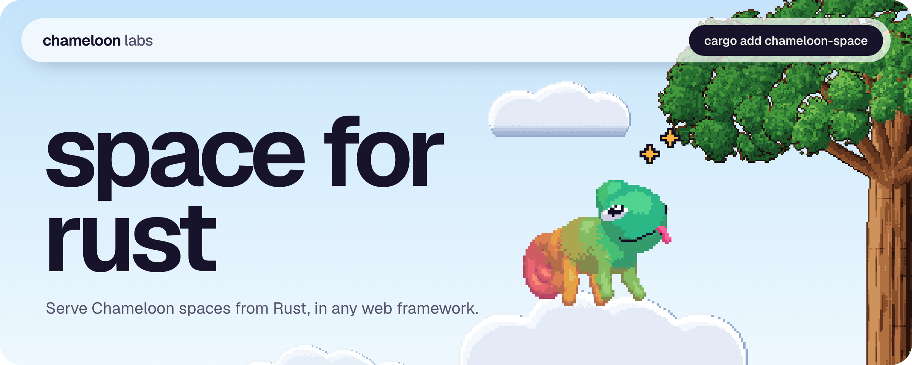
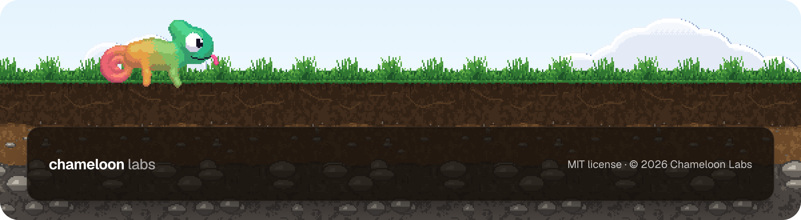

<a href="https://github.com/Chameloon-Labs/space-rust"></a>

<p align="center">
  <a href="https://chameloon.com/docs/"></a>
  <a href="https://chameloon.com/docs/protocol/"></a>
</p>

The Rust server SDK for Chameloon spaces: serve space folders, sync with the app, check device keys and write bots.

It passes the Chameloon [conformance suite](https://github.com/Chameloon-Labs/conformance) and keeps `auth.json` and `server-data.json` in the same format as the TypeScript SDK, so a space can move between servers.

## Install

```sh
cargo add chameloon-space
```

The default `serve` feature adds a small bundled HTTP server (`tiny_http`). The core `Server` has no web framework. To use it inside your own server, turn the default off:

```sh
cargo add chameloon-space --no-default-features
```

## Quick start

A spaces folder has one sub-folder per space. A sub-folder is a space when it has a `space.json`:

```
spaces/
  todo/
    space.json
    pages/home.oui
    img/logo.png
```

Serve it:

```rust
use std::sync::Arc;
use chameloon_space::{serve, Server};

fn main() -> std::io::Result<()> {
    let server = Server::new("spaces"); // .token("secret") makes every request need a Bearer token
    serve(Arc::new(server), "0.0.0.0:8787")
}
```

Then add `http://<your address>:8787/todo` in the app.

## Writing a bot

A bot is the code behind a space. Implement `Bot` and register it by space name. Every method is optional.

```rust
use chameloon_space::{Bot, Op, Row, Server, Store};
use serde_json::{json, Value};

struct Echo;

impl Bot for Echo {
    // Runs for each change a phone sent.
    fn on_op(&mut self, op: &Op, store: &mut Store, device: &str) {
        if op.table == "notes" && op.op == "upsert" {
            let text = op.row["text"].as_str().unwrap_or("");
            let Value::Object(reply) = json!({ "id": format!("re-{}", op.row["id"]), "text": format!("echo: {text}") }) else { return };
            store.put("replies", reply);
            store.notify("Echo", "You have a reply");
        }
    }
}

let server = Server::new("spaces").bot("echo", Echo);
```

The methods:

- `tick(store)` runs on every sync before the answer is built.
- `on_op(op, store, device)` runs for each stored change.
- `on_event(event, data, store, device)` runs for a page's `Mutation("send", ...)`. Events are not stored.
- `hook(body, store, headers)` answers `POST /<space>/hook` for other services. Return `Some(json)` to answer, `None` for no hook (the server then answers 404). The bot checks who is calling.

`Store` has `rows(table)`, `put(table, row)` and `notify(title, body)`. Bots run one request at a time per space.

`notify` queues the note and sends it with the phone's next sync. This SDK does not post to a push relay, so it does not reach a phone whose app is closed.

## Mounting in axum

`Server::handle` takes an `http::Request<Vec<u8>>` and returns an `http::Response<Vec<u8>>`, so it fits any framework built on the `http` crate. It blocks while it reads and writes files, so call it from `spawn_blocking`. With axum (add `axum`, `tokio`, `http`):

```rust
use std::sync::Arc;
use axum::{body::{to_bytes, Body}, extract::State, http::Request, response::Response, Router};
use chameloon_space::Server;

async fn spaces(State(server): State<Arc<Server>>, req: Request<Body>) -> Response {
    let (parts, body) = req.into_parts();
    let body = to_bytes(body, 16 * 1024 * 1024).await.unwrap_or_default().to_vec();
    let res = tokio::task::spawn_blocking(move || server.handle(http::Request::from_parts(parts, body))).await.unwrap();
    res.map(Body::from)
}

#[tokio::main]
async fn main() {
    let server = Arc::new(Server::new("spaces"));
    let app = Router::new().fallback(spaces).with_state(server);
    let listener = tokio::net::TcpListener::bind("0.0.0.0:8787").await.unwrap();
    axum::serve(listener, app).await.unwrap();
}
```

The signature check uses the path and query exactly as requested. If you nest the router under a prefix, pass the full original URI to `handle`.

## The command line

```sh
cargo install chameloon-space
chameloon-serve spaces --port 8787 --token secret
```

`PORT`, `SPACES` and `TOKEN` work as environment variables too. For spaces with `"auth": "device"`:

```sh
chameloon-serve invite  spaces todo --uses 1 --note "Anna's phone"   # prints a code; --uses unlimited
chameloon-serve devices spaces todo                                   # the phones that are in
chameloon-serve revoke  spaces todo <key or phone id prefix>          # shut one phone out
```

## Access

Set `auth` in a space's `space.json`:

- `"open"` (the default): anyone with the address.
- `"token"`: one shared secret. The app sends `Authorization: Bearer <token>`. The token is `token` in the space's `auth.json`.
- `"device"`: every phone signs every request with its own key (ECDSA P-256). A phone the server does not know yet must bring an invite code once. No shared secret travels, a copied request cannot be replayed, and one phone can be revoked.

Invites and known phones are in `auth.json`, which is never served:

```json
{ "invites": [{ "code": "K7QM-3XRP", "uses": 1, "note": "Anna's phone" }],
  "devices": [{ "key": "<base64>", "device": "<phone id>", "added": "2026-11-10T12:00:00.000Z" }] }
```

Create invites with `chameloon-serve invite` or `chameloon_space::new_invite`. `--token` on the server is separate: it guards every space at once.

## Links

- Docs: https://chameloon.com/docs/
- Protocol: https://chameloon.com/docs/protocol/

MIT license.

<br />

